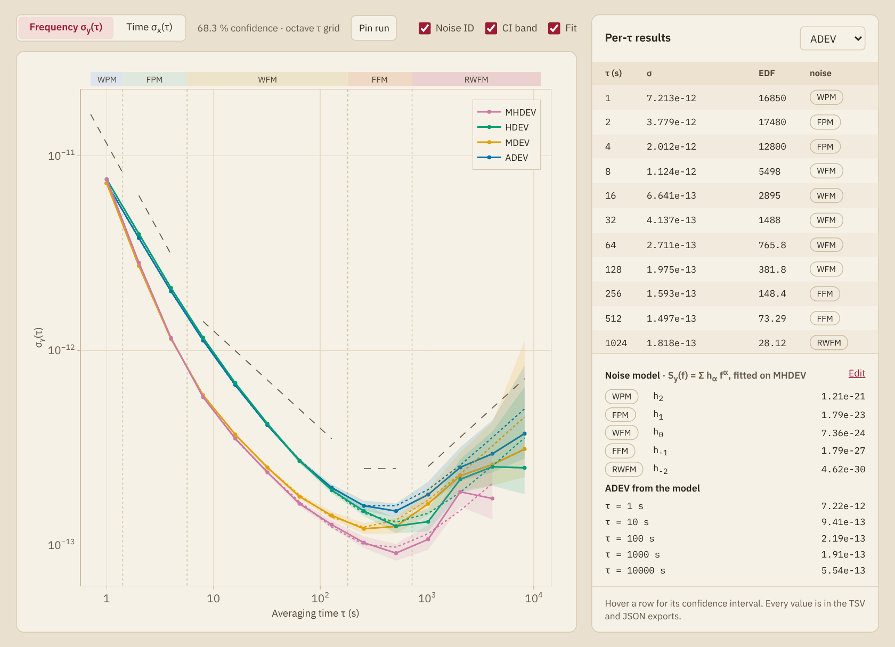

# SigmaTau.jl

[](https://github.com/ianlap/SigmaTau.jl/actions/workflows/CI.yml?query=branch%3Amain)
[](https://ianlap.github.io/SigmaTau.jl/stable/)
[](https://ianlap.github.io/SigmaTau.jl/dev/)
[](LICENSE)

SigmaTau.jl measures the stability of clocks and oscillators from records
of phase or fractional frequency. It computes the Allan and Hadamard
deviations with their modified, time and total forms, Thêo1, ThêoH and the
parabolic deviation, and at each averaging time it identifies the noise
type and gives a χ² confidence interval. Around them it has spectra and
phase noise, MTIE with telecom masks, tools to prepare a record, a clock
model with a Kalman filter, steering loops, and time scales formed from
several clocks.

```julia
using SigmaTau, Random

# 8192 phase samples at 1 s: white FM of 1e-12 at 1 s, and random-walk FM
p = noise_gen(PhaseData, 8192, 1.0; sigma1 = Dict(0 => 1e-12, -2 => 3e-14),
              rng = Xoshiro(5))
adev(p)
```

```text
StabilityResult(:adev, 12 pts, τ∈[1, 2048] s, with CI)
   tau        dev  neff      ci_lo      ci_hi    edf  noise
     1  1.001e-12  8190  9.919e-13   1.01e-12   6410  WHFM
     2  7.093e-13  8188  7.019e-13  7.169e-13   4437  WHFM
     4  4.949e-13  8184  4.881e-13  5.021e-13   2518  WHFM
     8  3.654e-13  8176  3.586e-13  3.726e-13   1373  WHFM
    16  2.786e-13  8160  2.715e-13  2.862e-13    722  WHFM
    32  2.335e-13  8128  2.245e-13  2.436e-13  298.2  FLFM
    64   2.25e-13  8064  2.116e-13  2.413e-13  117.1  RWFM
   128  2.646e-13  7936  2.431e-13  2.932e-13  57.78  RWFM
   256   3.37e-13  7680  2.998e-13  3.928e-13  28.12  RWFM
   512  4.833e-13  7168  4.117e-13  6.129e-13   13.3  RWFM
  1024  5.832e-13  6144  4.683e-13   8.68e-13  5.896  RWFM
  2048  9.802e-13  4096  7.283e-13  2.189e-12  2.235  RWFM
```

Each row is one averaging time: the deviation, the number of terms
averaged, the limits of the 68.3 % confidence interval, the equivalent
degrees of freedom and the noise type identified. A measurement takes the
place of the simulated record:

```julia
p = read_data("clock.csv")          # a table, or the file of an instrument
suite = stability(p; devs = (:adev, :mdev, :hdev))

using Plots
plot(suite)                         # the curves with their intervals
```

## Install

```julia-repl
pkg> add SigmaTau
```

installs the latest registered release, and
`pkg> add https://github.com/ianlap/SigmaTau.jl` the repository as it
stands. The package needs Julia 1.11 or later. `Plots` is optional: loading
it turns on the plot recipes.

A [release](https://github.com/ianlap/SigmaTau.jl/releases) also carries
two programs that need no Julia: the explorer as a desktop app, and the
`sigmatau` command-line program, each for macOS and Linux.

## What it computes

| | Functions |
|:---|:---|
| Allan family | `adev`, `mdev`, `tdev` |
| Hadamard family | `hdev`, `mhdev`, `htdev` |
| Total estimators | `totdev`, `mtotdev`, `ttotdev`, `htotdev`, `mhtotdev` |
| Thêo and parabolic | `theo1`, `theoh`, `pdev` |
| Time interval error | `mtie`, `tierms`, `mask_check` |
| Dynamic and live stability | `dadev`, `dhdev`, `StreamingStability`, `LiveStability` |
| Several clocks | `ncornered_hat`, `groslambert`, `cross_adev` |
| Spectra | `psd_y`, `psd_x`, `ssb_phase_noise`, `integrated_jitter`, `cross_psd_y` |
| Noise | `identify_noise`, `powerlaw_fit`, `noise_gen` |
| Preparing a record | `read_data`, `fillgaps`, `remove_outliers`, `detrend`, `drift_fit` |
| Clock model and Kalman filter | `noise_fit`, `clock_model`, `kalman_filter`, `holdover` |
| Steering | `steering_gains`, `steer` |
| Time scales | `timescale`, `simulate_ensemble` |

The estimators take a `PhaseData` or `FrequencyData` record, and the
averaging factors as a vector or as a named grid such as `Octave` or
`Decade`. The
[reference](https://ianlap.github.io/SigmaTau.jl/dev/reference/estimators/)
documents every function.

## Ways to use it

| | For | Start with |
|:---|:---|:---|
| Julia | scripts, notebooks and batch work | [Getting started](https://ianlap.github.io/SigmaTau.jl/dev/getting_started/) |
| Explorer | reading a file and its curves without writing code | [The explorer](https://ianlap.github.io/SigmaTau.jl/dev/explorer/) |
| Command line | shell scripts and other languages, with CSV or JSON output | [Command line](https://ianlap.github.io/SigmaTau.jl/dev/guide/cli/) |
| Python | the same functions from Python | [Python](https://ianlap.github.io/SigmaTau.jl/dev/guide/python/) |

All four run the same code. Python calls the Julia functions themselves.
The compiled program, which the explorer also runs, is tested to give their
results within a relative difference of 10⁻¹².

### Explorer

The explorer reads a file, shows what is in it, and plots the deviations,
the spectra and the dynamic stability of one clock or several. From a
checkout of the repository it runs in a browser:

```bash
python3 app/web/serve.py --open          # http://127.0.0.1:9385
```



[`app/web/README.md`](app/web/README.md) covers the pages and their tests,
and [`app/desktop/README.md`](app/desktop/README.md) the desktop app.

### Command line

`sigmatau` is the package as one compiled program. It needs no Julia and
starts in a few tens of milliseconds:

```bash
sigmatau check clock.dat                                # samples, gaps, outliers, drift
sigmatau analyze clock.dat --devs adev,mdev,tdev        # CSV on standard output
sigmatau analyze clock.dat --format json --out result.json
sigmatau report clock.dat --out clock.html              # one HTML file
```

`sigmatau help` lists the other commands: spectra, dynamic stability,
drift models, holdover tests, two-channel measurements, time scales, the
deviation that a clock model predicts, and live readings from an
instrument.
[`cli/README.md`](cli/README.md) says how to build it.

### Python

The `sigmatau` Python package calls the Julia functions of the same names
([`python/README.md`](python/README.md)):

```python
import sigmatau as st

p = st.read_data("clock.csv")
r = st.adev(p)
r.tau, r.dev, r.ci_lower, r.ci_upper, r.noise_type
```

## Validation

The test suite compares the deviations, the equivalent degrees of freedom,
the confidence limits, the spectra and the drift fits with allantools,
AllanDeviations.jl, scipy and result files of Stable32, on records of each
noise type from white PM to random-run FM, and it reproduces the published
deviations of the test suite of NIST SP1065. Each estimator is also tested
against a direct evaluation of its defining sum.
[Validation](https://ianlap.github.io/SigmaTau.jl/dev/explanation/validation/)
describes the evidence, and the
[cross-check report](https://ianlap.github.io/SigmaTau.jl/dev/explanation/crosscheck/)
lists every comparison with its tolerance.

Where the package departs from a source, or goes beyond one, the page of
the documentation that covers the subject says so and says what the choice
rests on.
[Related software](https://ianlap.github.io/SigmaTau.jl/dev/explanation/related/)
describes the other programs and what each computes.

## Speed

[`bench/`](bench/README.md) times the kernels against allantools and
AllanDeviations.jl on the same samples. On a record of 25 000 samples, with
12 threads and version 0.5.0 of this package, ADEV, MDEV, HDEV and TDEV
took 12 to 27 times less time than in allantools, TOTDEV 71 times less, and
MTOTDEV and HTOTDEV about 4000 times less (26 ms against 108 s). Those are
the kernels alone. The default call also identifies the noise and computes
the intervals, which the allantools call does not, and for the first five
the ratio then fell to between 2 and 10. Noise identification does more
work since that version, and the default call of those five now takes about
twice as long. The benchmark page gives the method, the machine and the
tables.

## Documentation

The [documentation](https://ianlap.github.io/SigmaTau.jl/dev/) has
tutorials, how-to guides, the manual of the explorer, background pages on
what the numbers rest on, and the reference of every exported function.
Good places to start:

- [Getting started](https://ianlap.github.io/SigmaTau.jl/dev/getting_started/),
  from a set of samples to a stability plot;
- [Choosing an estimator](https://ianlap.github.io/SigmaTau.jl/dev/guide/choosing/);
- [Coming from Stable32](https://ianlap.github.io/SigmaTau.jl/dev/guide/from_stable32/)
  and
  [Coming from allantools](https://ianlap.github.io/SigmaTau.jl/dev/guide/from_allantools/).

## Contributing

[`CONTRIBUTING.md`](CONTRIBUTING.md) says what a change should come with
and how to run the tests and build the documentation. The tests of the
package run with

```bash
julia --project=. -e 'using Pkg; Pkg.test()'
```

## Citing and license

To cite the package, use [`CITATION.cff`](CITATION.cff), which GitHub
shows under *Cite this repository*. The definitions follow the NIST
handbook of frequency stability analysis (SP1065) and IEEE Std 1139-2022,
and the confidence intervals use the equivalent degrees of freedom of
Greenhall and Riley (2003). The
[bibliography](https://ianlap.github.io/SigmaTau.jl/dev/bibliography/)
lists every source.

SigmaTau.jl is released under the [MIT license](LICENSE).
