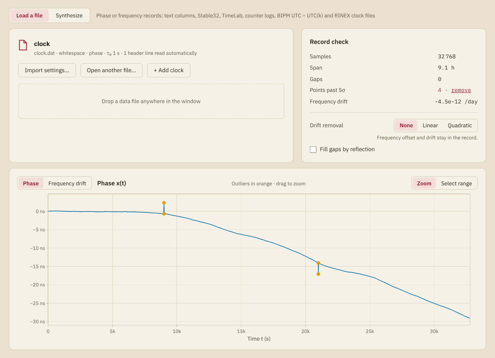
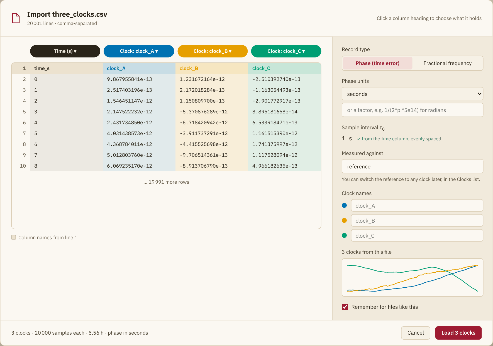

# Data

The Data page holds the record: where it comes from, how it was read, what
is in it and what is done to it before every analysis. With several clocks
it shows one of them, the one clicked in the
[list of clocks](panel.md#Clocks).

## Opening a file

**Open a file…** opens a text file of readings, and a file dropped anywhere
in the window opens the same way. Once a file is loaded the card shows its
name and how it was read, with three buttons:

| Button | Action |
|:-------|:-------|
| **Import settings…** | Opens the import dialog again for this file |
| **Open another file…** | Puts another file in the place of this clock |
| **+ Add clock** | Opens a file as a further clock and keeps those loaded |

The explorer reads the files that [`read_data`](@ref) reads:

- text in columns, separated by blanks, commas or tabs, with `NaN` for a
  missing sample. Lines that start with `#` are skipped, and a first line of
  names is taken as the names of the columns;
- Stable32 phase and frequency files (`.phd`, `.frd`) and TimeLab files
  (`.tim`), with the sample interval from their headers;
- the readings of a counter, one per line in the number format of SCPI
  (`+9.999999999E+06`): frequencies in hertz become fractional frequency,
  and time intervals become phase;
- tables with named columns and ISO 8601 timestamps;
- the BIPM files of UTC − UTC(k);
- RINEX clock files (`.clk`), from which the clocks are chosen in a list.

A file compressed with gzip (`.gz`) is unpacked as it is opened.

## The import dialog

The dialog shows the top of the file and what the explorer proposes to read
from it. The proposal comes from the names of the columns, the header and
the size of the values. When several columns are named for readings, such as
`maser1 phase (s)` and `maser2 phase (s)`, each is proposed as a clock, and the
button counts them (**Load 6 clocks**). Check the proposal before loading, the record
type above all.

The heading of each column is a menu:

| Choice | The column holds |
|:-------|:-----------------|
| **Ignore** | Nothing to read |
| **Time (s)**, **Time (days, MJD)**, **Time (h)**, **Time (min)** | The time of each reading, in that unit |
| **Clock** | The readings of one clock |

Every column marked **Clock** becomes a clock, all measured against the same
reference at the same instants. A click on the name of a column adds it as
a clock or drops it.

| Setting | Meaning |
|:--------|:--------|
| **Record type** | **Phase (time error)** or **Fractional frequency** |
| **Phase units**, **Frequency units** | Seconds to picoseconds for phase, and fractional, ppm, ppb or ppt for frequency. The field below takes a factor instead, written as an expression of numbers, `pi`, `+ - * /` and parentheses, such as `1/(2*pi*5e14)` for the phase of an optical carrier in radians |
| **Sample interval τ₀** | The step of the time column, or the interval that the header states. Without either it has to be typed |
| **Measured against** | The name of the reference, shown beside **As measured** in the list of clocks |
| **Clock name**, **Clock names** | The name of each clock on the plots and in the exports |
| **Remember for files like this** | Reads the next file with the same extension, number of columns and column names without the dialog |

When the time column skips readings, the dialog counts the gaps and the
missing samples. They enter the record as missing samples.

In a Stable32 file (`.phd`, `.frd`) a zero marks a missing sample, except
the first and the last sample of a phase file. The dialog counts these
zeros and reads them as missing samples. **Keep zeros as readings** reads
them as samples, for a record whose zeros are readings, as quantized data
can have.

A file that is read with remembered settings says so in the status bar. A
Stable32 file with zeros opens the dialog all the same, unless the
remembered settings keep them.
**Import settings…** on the Data page opens the dialog for it. Files of
different kinds that share an extension and a layout share the remembered
settings too, so check the line under the file name.

## Simulated records

**Synthesize** makes a record in place of a file, from the number of
samples, the sample interval and a seed. Its noise is white FM with a
random walk of the frequency, of ``10^{-12}`` and ``10^{-14}`` per sample
as standard deviations. The same seed gives the same record.

| Field | Range |
|:------|:------|
| **Clocks** | 1 to 8 |
| **Samples** | 64 to 10,000,000 |
| **τ₀ (s)** | The sample interval |
| **Seed** | A whole number |

With several clocks, each is noisier than the one before by a factor of two
in deviation, and all are simulated against one ideal reference. The
[Ensemble](ensemble.md) page forms its time scale from them. The
[Synthesis](synthesis.md) page simulates clocks from a noise model of
your own.

## The record check

The record check is computed when the record is read and again whenever its
preparation changes. It describes the record as prepared.

| Line | Meaning |
|:-----|:--------|
| **Samples** | The number of phase samples, with the missing ones. A frequency record of ``N`` readings has ``N + 1`` |
| **Span** | The number of samples times the sample interval |
| **Start** | The time of the first sample in UTC, for a file with timestamps |
| **Gaps** | The number of missing samples |
| **Points past 5σ** | The outliers that [`find_outliers`](@ref) finds: frequency samples more than five scaled median absolute deviations from the median. They are marked on the phase plot |
| **Frequency drift** | The slope of a least-squares line through the fractional frequency, per day. It reads **Drift left** after a quadratic removal |

## Preparing the record

Three steps are applied before every analysis, the check and the plots
included. [Gaps, outliers and drift](../guide/preparing.md) says when each
is called for.

**Drift removal** fits the phase by least squares over the samples that are
not missing and removes the fit. **Linear** removes a line, which takes out
a frequency offset. **Quadratic** removes a parabola, which takes out a
linear frequency drift as well. The check then lists the offset and the
drift that were removed.

**Fill gaps by reflection** fills the missing samples as
[`fillgaps`](@ref) does, from the samples beside each gap, reflected into
it. The missing samples are the readings that the time column skips, those
written as `NaN` and the zeros of a Stable32 file that are read as
missing. For a frequency record that has any of them it is on from the
start, since a frequency record cannot be read with samples missing.

**remove**, beside the count of outliers, replaces them as
[`remove_outliers`](@ref) does. The missing samples of the record stay
missing. **undo** brings the outliers back.

!!! note "Records with gaps"
    A phase record with missing samples is analyzed as it is by the
    estimators that leave them out
    ([Estimators and noise types](estimators.md)). An estimator that needs
    a complete record stops the run with an error, and the
    [Spectrum](spectrum.md#Records-with-gaps) page has no spectrum for the
    record. A frequency record with missing samples cannot be read while
    **Fill gaps by reflection** is off, and the record check then keeps
    that box alone, to turn the filling back on.

## The phase plot and the analysis range

The **Phase** view plots the phase of the record as prepared, with the
outliers marked. A drag zooms, and a double click restores the full range.
The curve breaks where samples are missing. A record of more than 4000
samples is cut into 1332 stretches, and the curve runs through the lowest
and the highest sample of each and through the two ends of the record, so
that it keeps every outlying sample.

**Select range** turns the drag into a choice of the part of the record to
analyze. The range is shaded, and the line above the plot gives its limits.
It needs at least 16 samples. The Stability, Spectrum, Dynamic, Holdover
and Steering pages, and the Histogram and Autocorrelation views, then use
that part alone, with the drift removal fitted
to it. The check and the plot keep the whole record. **whole record**
clears the range. Each clock has its own.

## Frequency drift

The **Frequency drift** view plots the fractional frequency of the record
as prepared and fits one of four models to it by least squares, as
[`drift_fit`](@ref) does:

| Model | Frequency |
|:------|:----------|
| **Linear** | ``a + b\,t`` |
| **Quadratic** | ``a + b\,t + c\,t^2`` |
| **Log** | ``a \ln(1 + b\,t) + c`` |
| **Diffusion** | ``a + b\sqrt{t + c}`` |

**Estimator** chooses how the drift of the linear model is found. The
other models are least-squares fits.

| Estimator | Drift | Least variance on |
|:----------|:------|:------------------|
| **Line through frequency** | slope of the least-squares line through the frequency | white FM |
| **Parabola through phase** | twice the curvature of the least-squares parabola through the phase | white PM |
| **Bisection (three-point)** | mean frequency of the second half of the record less that of the first, over half its length | |
| **Mean second difference** | mean of the second differences of the phase | random-walk FM |
| **Four-point** | the estimator of [Greenhall 1997](@cite greenhall-1997-drift-estimator), from four values of the summed phase | |

The bisection stays close to the least variance on white, flicker and
random-walk FM, and the four-point estimator on every power-law noise.
The four-point estimator needs a record without gaps. [`drift_fit`](@ref)
gives the formulas and their sources.

The line above the plot gives the drift rate at the end of the record, per
day, with its standard error and the rms of the residuals. Hovering over it
shows the coefficients. **Residuals** plots what the model leaves.

The standard error of a least-squares fit assumes white residuals. It is
too small where they are not white, as on a record with flicker or
random-walk FM. That of the mean second difference is the standard
deviation of the mean of the differences, and assumes random-walk FM. The
bisection and the four-point estimator show none: theirs follows from the
deviation of the record at an averaging time too long for the record to
measure.

To fit the drift of the record as measured, set **Drift removal** to
**None**: the view shows the frequency after the removal.

## Histogram and statistics

The **Histogram** view plots the histogram of the samples, as Stable32's
Histogram function does, and lists the statistics of its Statistics
function beside it ([`sample_statistics`](@ref), [`sample_histogram`](@ref)).
**Phase** and **Frequency**, in the line above the plot, choose the samples: those of the record by
default, or the record converted to the other kind. A distribution far from
normal, such as one with two peaks, points to a problem with the record.

| Statistic | Meaning |
|:----------|:--------|
| **Points** | The samples measured, with the number missing |
| **Min**, **Max**, **Mean**, **Median** | Of the samples measured |
| **Std dev** | Their standard deviation, with ``n - 1`` in the denominator |
| **Std dev (freq.)** | For phase, that of the fractional frequency: the Std Dev that Stable32 shows for either kind of record |
| **σy(τ0)** | The Allan deviation at the sample interval |
| **Noise** | The noise type identified at the sample interval |

The standard deviation of phase grows with the length of the record under
any frequency noise, so it describes that record only. That of the
frequency, **Std dev (freq.)**, is the one to compare with
**σy(τ0)**: for white FM the two agree, apart from the
scatter of the estimates.

**Bins** sets the number of bins. Left empty it follows Scott's rule, with
at most 1000. **Normal curve** draws, in crimson, the normal distribution
with the mean and the standard deviation of the samples, scaled to the
expected count in each bin. Samples far from zero next to their spread, such
as a frequency offset with little noise on it, are plotted less their mean,
which the axis title gives.

## Autocorrelation

The **Autocorrelation** view plots the autocorrelation of the samples
against the lag, as Stable32's Autocorrelation function does
([`acf`](@ref)). **m** is the averaging factor: the phase is taken every
``m`` samples and the frequency averaged over ``m``. **Lags** sets the
largest lag; left empty it is half the series, and at most 1000. The value
at lag 1 tells the noise types apart
([SP1065 §5.5.4](@cite riley-2008-sp1065)):

| Noise | Autocorrelation of frequency at lag 1 |
|:------|:--------------------------------------|
| White PM | ``-1/2`` |
| Flicker PM | ``-1/3`` |
| White FM | 0 |
| Flicker FM and the more divergent noises | Positive, nearer 1 the longer the record |

A periodic component shows as an oscillation of its period. The list beside
the plot gives ``r_1``, the lag-1 estimate of ``α`` that
[`identify_noise`](@ref) rounds to a noise type, and that type. For a mix of
two noises ``α`` falls between their values. It needs a record of
``30 m`` samples or more.
The autocorrelation needs a record without missing samples: turn on
**Fill gaps by reflection**.

