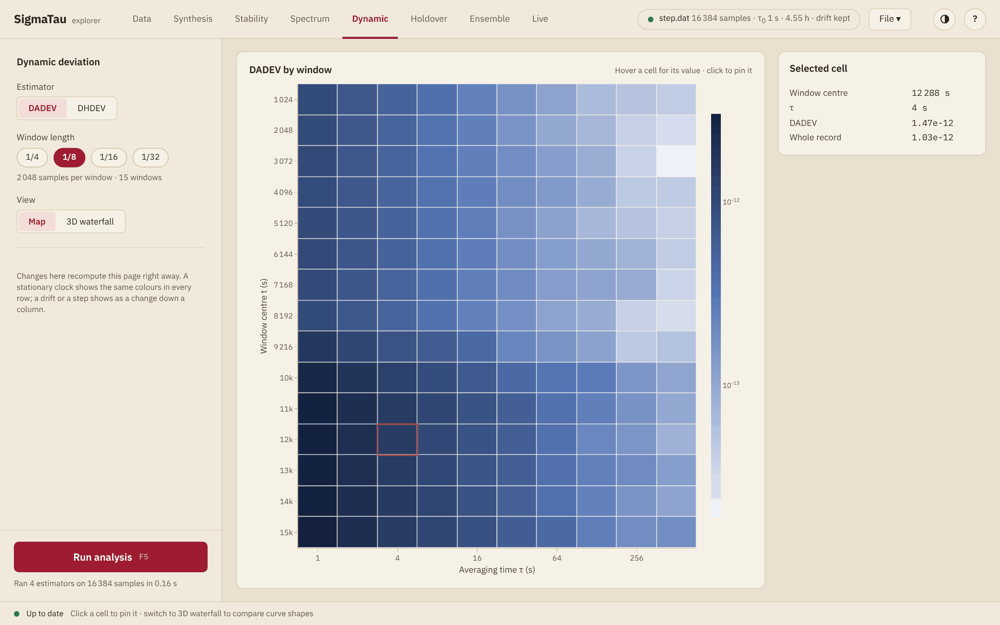

# Dynamic

The Dynamic page shows whether the stability of a clock changes during the
record. It computes the Allan or the Hadamard deviation in a window that
slides along the record and draws the result as a map of time against
averaging time
([Galleani and Tavella (2009)](@cite galleani-2009-davar)). A single curve
of ``σ_y(τ)`` averages over the whole record. The map shows a step in the
noise level, a burst or a disturbed stretch where it happens.

## Settings

| Setting | Effect |
|:--------|:-------|
| **Estimator** | **DADEV**, the dynamic Allan deviation of [`dadev`](@ref), or **DHDEV**, the dynamic Hadamard deviation of [`dhdev`](@ref), which does not respond to linear frequency drift within a window |
| **Window length** | A quarter, an eighth, a sixteenth or a thirty-second of the record, and 16 samples at least. The line below gives the samples in a window and the number of windows |
| **View** | **Map**, or **3D waterfall**, a surface that a drag turns |

The window moves by half its length, so a window of one eighth of the
record gives 15 windows. The averaging times are those of the τ grid of the
[side panel](panel.md#Options) that fit in one window. A shorter window
follows changes more closely, reaches shorter averaging times only and
scatters more, since each cell rests on the samples of one window.

The page computes its maps when it is shown and again when the record, its
preparation, its analysis range or a setting changes. It needs no run, and
the estimators of the panel have no part in it. The record must have no
missing samples.

## The map

Each row is a window, placed at the time of its center, and each column an
averaging time. The color gives the deviation on a logarithmic scale, from
the color of the card for the lowest value to the strongest color for the
highest.

A clock whose noise does not change shows the same color down each column,
within the scatter of the estimate. A change during the record shows as a
change down the columns.

Hovering over a cell shows its value, and a click pins it. **Selected
cell** then lists the time of the window's center, the averaging time, the
deviation in that window, and under **Whole record** the ADEV or HDEV of
the whole record at that averaging time, from the last run. That line is
empty when the estimator was not in the last run or the averaging time not
on its grid.

The map carries no confidence intervals. Each row is the deviation of one
window of samples, so its interval is that of [`adev`](@ref) or
[`hdev`](@ref) on a record of the window's length.

## Several clocks

With several clocks, each has its own map, on one color scale, and the
settings move to a bar above the maps. There is no 3D view and no selected
cell.

**Compare at τ**, below the maps, plots the deviation of every clock
against the time of the window, at one averaging time. A dotted line gives
the value of each clock over the whole record, from the last run. The menu
of the card or a click on a column of a map changes the averaging time. A
clock with another sample interval is shown at its nearest averaging time,
within half an octave, which the legend then names.
