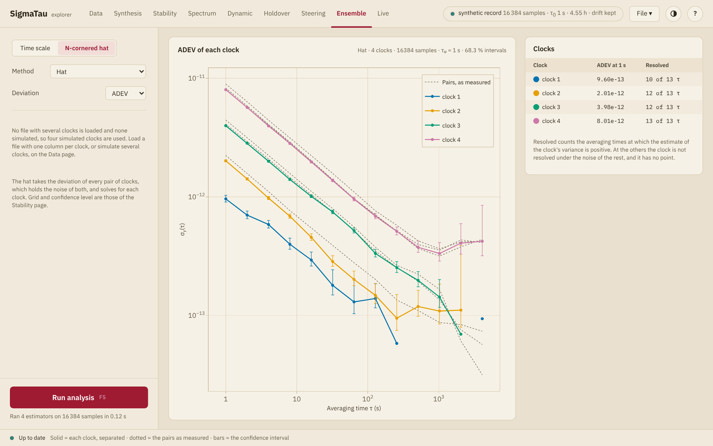

# Ensemble

The Ensemble page works on a group of clocks that were measured against
one reference, in two views. **Time scale** forms a time scale from them: a
weighted combination of the clocks that is meant to be more stable than any
one of them. It shows the stability of the scale, the stability of each
clock against it and the weight of each clock. **N-cornered hat** separates
the stability of each clock from the comparisons, without a scale
([The N-cornered hat](ensemble.md#The-N-cornered-hat)).

## The clocks

The page takes its clocks from the first of these that it finds:

1. the clock columns of one loaded file of plain columns, two or more,
   read at the same instants against the same reference;
2. clocks simulated together on the [Data](data.md#Simulated-records) or
   [Synthesis](synthesis.md) page;
3. four simulated clocks of its own, of 16384 samples at 1 s.

A note in the side panel says which clocks are in use. A clock chosen as
the **Reference** in the list of clocks is left out of the scale, and so is
a clock removed with ×. A hidden clock stays in. The hat keeps the clock
chosen as the **Reference**: it works on the difference of every pair of
clocks, which that choice does not change.

Both views take the columns as the
[import dialog](data.md#The-import-dialog) reads them. The drift removal,
the gap filling, the outlier removal and the analysis range of the Data
page do not apply here.

Where phase columns have missing samples, the scale is formed without the
clock at those samples
([Clocks that drop out and return](../reference/ensemble.md#Clocks-that-drop-out-and-return)).
Greenhall, Jones–Tryon and Stein first fit a model to each clock, from the
samples at which it is read with two others. A file that leaves a clock too
few of them stops the fit; AT1, AT2 and EWFA form a scale from it.
Frequency columns with missing samples cannot be read.

## Settings

These are the settings of the **Time scale** view.

| Setting | Algorithms | Effect |
|:--------|:-----------|:-------|
| **Algorithm** | | One of the six below |
| **Pivot clock** | Greenhall, Jones–Tryon, Stein | The clock at which the scale is read |
| **Largest weight** | AT1, AT2, Stein | The largest weight one clock may have, from ``1/k`` for ``k`` clocks to 1, which is no limit |
| **Frequency steps** | AT2 | **Off**, **Best** or **Real**: whether the scale looks for frequency steps of a clock, and what it does on finding one |
| **Flicker states** | Greenhall, Jones–Tryon | **Off** or **On**: whether the model of each clock keeps its flicker FM and flicker PM |

| Algorithm | Scale |
|:----------|:------|
| **AT1** | Weighs each clock by the inverse of the variance of its prediction error, which the scale estimates as it runs ([Weiss and Weissert (1991)](@cite weiss-weissert-1991-at2)) |
| **AT2** | AT1 with the frequency of each clock followed by a Kalman filter, from the same paper. With **Frequency steps**, a clock whose frequency steps is left out for a time. **Best** forms the scale again from the step on, and **Real** keeps the values already issued and corrects those that follow |
| **EWFA** | Weighs every clock the same ([Kettering (2023), §3.1](@cite kettering-2023-clock-ensemble)) |
| **Greenhall** | One Kalman filter over all the clocks, with the covariance reduction of [Greenhall (2003)](@cite greenhall-2003-jones-tryon), read at the pivot clock |
| **Jones–Tryon** | The same filter without the reduction ([Jones and Tryon (1983)](@cite jones-tryon-1983-estimating-time)). It defines no weights |
| **Stein** | The scale of [Stein (2003)](@cite stein-2003-demystified), in the form that [Levine (2012)](@cite levine-2012-statistical-modeling) describes as KAS-2: a Kalman filter on the difference of each clock from the pivot, with weights for phase, frequency and aging. The weights shown are those of the phase |

[`timescale`](@ref) describes each algorithm, its equations and where it
departs from its source. The three Kalman scales need three or more clocks.
They fit a model to each clock from the comparisons alone, as
[`clock_models`](@ref) does.

The model of a clock has white FM and random-walk FM, with the PM as the
noise of its readings. With **Flicker states** off, flicker PM counts as
noise of the readings too, and flicker FM is not fitted. With them on,
flicker FM is fitted as well, and the model keeps the flicker FM and the
flicker PM it finds as
[Markov states](../explanation/clock_model.md#Flicker-states), over the
averaging times at which each matters. The levels are those that the fit
finds, and on a short record it can find flicker in a clock that has none:
of four simulated clocks of white and random-walk FM, 2048 samples long,
one got two flicker FM states.

The page forms the scale when it is shown and again when the clocks or a
setting change. It needs no run.

## What is shown

The upper plot gives the Allan deviation of the scale against the
reference, as a solid line, and that of each clock against the scale, as
dotted lines. The line above it names the algorithm, the number of samples,
the sample interval and the reference, and says when flicker states are
on.

With simulated clocks the reference is ideal, and the solid line is the
stability of the scale itself. With measured clocks it holds the noise of
the reference as well, and it shows the scale only where the reference is
the more stable of the two.

**Weights** plots the weight of each clock against time. The table gives,
for each clock:

| Column | Holds |
|:-------|:------|
| **Weight** | The weight at the end of the record |
| **Mean** | The mean weight over the second half of the record |
| **RMS error** | The rms prediction error over the second half, in seconds |
| **White FM** | For a Kalman scale, the white FM ``q_1`` of the model fitted to the clock |

The Jones–Tryon scale has no weights: the plot of the weights is not shown,
and the two weight columns are empty.

Where the fit leaves a clock without white FM, the record does not resolve
that clock. A Kalman scale then gives it nearly all of the weight and
follows it, and the note under the table names it. AT1 takes no model.

With **Flicker states** on, the note below the table gives the number of
states in the model of each clock, as `2 FM + 1 PM`, or says that no clock
has flicker that needs them.

## The N-cornered hat

A comparison of two clocks holds the noise of both. With three or more
clocks compared in pairs, the noise of each can be separated: the variance
of a pair is the sum of the variances of its two clocks, if the clocks are
independent, and the pairs give enough such sums to solve for every clock
([Gray and Allan (1974)](@cite gray-1974-three-cornered-hat);
[SP1065 §10.14](@cite riley-2008-sp1065)). [`ncornered_hat`](@ref) gives
the equations and the intervals.

The clocks of a file are read against its reference, and the page forms
the difference of every pair, in which the reference cancels. The
reference is then one clock more, so a file with two clocks is enough.
Simulated clocks have an ideal reference, which counts as no clock: three
or more are needed.

| Setting | Effect |
|:--------|:-------|
| **Method** | **Hat**, **Groslambert covariance** or **Groslambert, KLTS interval**, described below |
| **Deviation** | The deviation that the hat separates: ADEV, MDEV, HDEV, MHDEV, PDEV, TDEV or HTDEV. The two covariance methods are defined for ADEV |
| **Columns hold** | Offered for a file with three columns. **Clocks**: each column is a clock read against the reference. **Pairs**: the columns are the differences A−B, B−C and C−A of three clocks, each measured on its own |
| **The reference counts as a clock** | Offered for a file with three or more clocks. Without the tick the reference is left out, and the hat has the clocks of the file alone |

| Method | Result |
|:-------|:-------|
| **Hat** | The deviation of every pair, solved for each clock ([`ncornered_hat`](@ref)) |
| **Groslambert covariance** | The average product of the second differences of two records that share a clock ([`groslambert`](@ref); [Vernotte et al. (2016)](@cite vernotte-2016-gcov)). Noise that one record of a pair has alone, such as that of its counter, stays out of the result. For three clocks read against one reference it equals the hat on ADEV, and it differs for **Pairs** |
| **Groslambert, KLTS interval** | The covariance with the interval of [Lantz et al. (2019)](@cite lantz-2019-klts) in place of the ``χ^2`` interval. It is offered for three clocks, and needs a file without missing samples |

The grid of averaging times and the confidence level are those of the
[side panel](panel.md#Options) on the Stability page. Where phase columns
have missing samples, the hat and the covariance leave out the terms that
touch them.

The plot gives the deviation of each clock as a solid line with its
confidence interval, over the deviation of each pair as measured, in thin
dotted lines. The table gives each clock's deviation at the shortest
averaging time and at how many averaging times it is **Resolved**.

The hat subtracts one measured variance from the sum of others, and the
result can be negative: for a clock much more stable than the rest, for
clocks whose noise is correlated, and where the samples are few, most
often at long ``τ``. A negative variance has no deviation. The clock is not
resolved at that averaging time and has no point there. With the KLTS
interval a ▽ marks the upper limit that the records set on such a clock.
