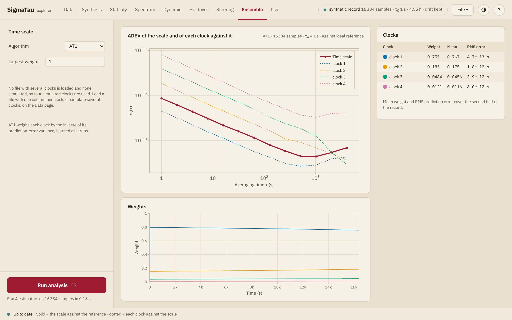

# Ensemble

The Ensemble page forms a time scale from a group of clocks that were
measured against one reference: a weighted combination of the clocks that
is meant to be more stable than any one of them. It shows the stability of
the scale, the stability of each clock against it and the weight of each
clock.

## The clocks

The page takes its clocks from the first of these that it finds:

1. the clock columns of one loaded file of plain columns, two or more,
   read at the same instants against the same reference;
2. clocks simulated together on the [Data](data.md#Simulated-records) or
   [Synthesis](synthesis.md) page;
3. four simulated clocks of its own, of 16384 samples at 1 s.

A note in the side panel says which clocks are in use. A clock chosen as
the **Reference** in the list of clocks is left out of the scale, and so is
a clock removed with ×. A hidden clock stays in.

The scale is formed from the columns as the
[import dialog](data.md#The-import-dialog) reads them. The drift removal,
the gap filling, the outlier removal and the analysis range of the Data
page do not apply here.

Where phase columns have missing samples, AT1, AT2 and EWFA form the scale
without the clock at those samples
([Clocks that drop out and return](../reference/ensemble.md#Clocks-that-drop-out-and-return)).
Greenhall, Jones–Tryon and Stein first fit a model to each clock, which
needs a file without missing samples. Frequency columns with missing
samples cannot be read.

## Settings

| Setting | Algorithms | Effect |
|:--------|:-----------|:-------|
| **Algorithm** | | One of the six below |
| **Pivot clock** | Greenhall, Jones–Tryon, Stein | The clock at which the scale is read |
| **Largest weight** | AT1, AT2, Stein | The largest weight one clock may have, from ``1/k`` for ``k`` clocks to 1, which is no limit |
| **Frequency steps** | AT2 | **Off**, **Best** or **Real**: whether the scale looks for frequency steps of a clock, and what it does on finding one |
| **Flicker states** | Greenhall, Jones–Tryon | **Off** or **On**: whether the model of each clock keeps its flicker FM and flicker PM |

| Algorithm | Scale |
|:----------|:------|
| **AT1** | Weighs each clock by the inverse of the variance of its prediction error, which the scale estimates as it runs ([Weiss and Weissert (1991)](@cite weiss-weissert-1991-at2)) |
| **AT2** | AT1 with the frequency of each clock followed by a Kalman filter, from the same paper. With **Frequency steps**, a clock whose frequency steps is left out for a time. **Best** forms the scale again from the step on, and **Real** keeps the values already issued and corrects those that follow |
| **EWFA** | Weighs every clock the same ([Kettering (2023), §3.1](@cite kettering-2023-clock-ensemble)) |
| **Greenhall** | One Kalman filter over all the clocks, with the covariance reduction of [Greenhall (2003)](@cite greenhall-2003-jones-tryon), read at the pivot clock |
| **Jones–Tryon** | The same filter without the reduction ([Jones and Tryon (1983)](@cite jones-tryon-1983-estimating-time)). It defines no weights |
| **Stein** | The scale of [Stein (2003)](@cite stein-2003-demystified), in the form that [Levine (2012)](@cite levine-2012-statistical-modeling) describes as KAS-2: a Kalman filter on the difference of each clock from the pivot, with weights for phase, frequency and aging. The weights shown are those of the phase |

[`timescale`](@ref) describes each algorithm, its equations and where it
departs from its source. The three Kalman scales need three or more clocks.
They fit a model to each clock from the comparisons alone, as
[`clock_models`](@ref) does.

The model of a clock has white FM and random-walk FM, with the PM as the
noise of its readings. With **Flicker states** off, flicker PM counts as
noise of the readings too, and flicker FM is not fitted. With them on,
flicker FM is fitted as well, and the model keeps the flicker FM and the
flicker PM it finds as
[Markov states](../explanation/clock_model.md#Flicker-states), over the
averaging times at which each matters. The levels are those that the fit
finds, and on a short record it can find flicker in a clock that has none:
of four simulated clocks of white and random-walk FM, 2048 samples long,
one got two flicker FM states.

The page forms the scale when it is shown and again when the clocks or a
setting change. It needs no run.

## What is shown

The upper plot gives the Allan deviation of the scale against the
reference, as a solid line, and that of each clock against the scale, as
dotted lines. The line above it names the algorithm, the number of samples,
the sample interval and the reference, and says when flicker states are
on.

With simulated clocks the reference is ideal, and the solid line is the
stability of the scale itself. With measured clocks it holds the noise of
the reference as well, and it shows the scale only where the reference is
the more stable of the two.

**Weights** plots the weight of each clock against time. The table gives,
for each clock:

| Column | Holds |
|:-------|:------|
| **Weight** | The weight at the end of the record |
| **Mean** | The mean weight over the second half of the record |
| **RMS error** | The rms prediction error over the second half, in seconds |

The Jones–Tryon scale has no weights: the plot of the weights is not shown,
and the two weight columns are empty.

With **Flicker states** on, the note below the table gives the number of
states in the model of each clock, as `2 FM + 1 PM`, or says that no clock
has flicker that needs them.
