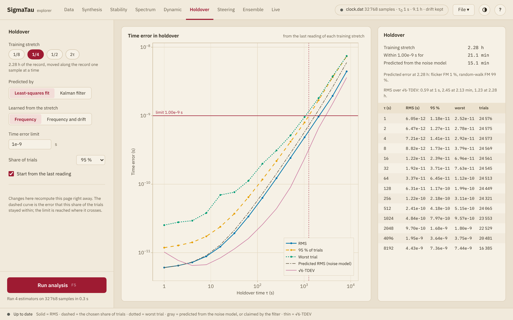

# Holdover

The Holdover page measures, on the record itself, how far a clock wanders
once its reference is gone. A least-squares line through a training
stretch of the phase gives the frequency of the clock. The clock then runs
on at that frequency from the last reading of the stretch, and the error
after a holdover time ``τ`` is the phase that the record shows there less
the phase predicted. The stretch moves along the record one sample at a
time, so each holdover time has many trials. The test is that of
[`holdover`](@ref), which [Holdover](../reference/holdover.md) describes.

## Settings

| Setting | Effect |
|:--------|:-------|
| **Training stretch** | **1/8**, **1/4** or **1/2** of the record, or **2τ**, a stretch twice as long as each holdover time. With the drift learned the last choice is **3τ**, three times as long. The line below gives the length |
| **Predicted by** | **Least-squares fit**, or **Kalman filter** ([below](@ref explorer-holdover-kalman)) |
| **Learned from the stretch** | **Frequency**, from a line, or **Frequency and drift**, from a parabola |
| **Time error limit** | A time error in seconds, such as `1e-6`. The page then gives how long the clock stays within it. Empty for no limit |
| **Share of trials** | 68.3 %, 90 %, 95 % or 99 %: the share of the trials whose error the dashed curve bounds |
| **Start from the last reading** | On, the clock starts from the last reading of the stretch. Off, it starts from the value of the fit there, which averages white PM down, and on a clock with random-walk FM starts from the misfit of the line |

The holdover times are the octave multiples of the sample interval, up to
the length of the training stretch and no further than half of what the
record has left after it. With **2τ** or **3τ** they go as far as leaves
half the record for the trials.

The page computes when it is shown and again when the record, its
preparation, its analysis range or a setting changes. It needs no run, and
the estimators of the panel have no part in it. The record needs 16
samples or more. A trial is left out when missing samples take more than
half of its training stretch, or the reading it starts from or is compared
with.

## The plot

The plot gives the time error against the holdover time, on logarithmic
axes.

| Curve | Shows |
|:------|:------|
| **RMS** | The root mean square of the error over the trials |
| **95 % of trials**, or the share chosen | The error that this share of the trials stayed within |
| **Worst trial** | The largest error of any trial |
| **Predicted RMS (noise model)** | The RMS error that a power-law model of the noise predicts for the same test. The model is fitted to the modified Hadamard deviation of the record, as that of **Fit** on the [Stability](stability.md#The-noise-model) page. A model built by hand there does not enter |
| **√6·TDEV**, or **√20·HTDEV** with the drift learned | The RMS error of predicting the next ``τ``-average of the phase from the two before it with a line, or from the three before it with a parabola. This is what the time deviation and the Hadamard time deviation measure |

With a limit set, a horizontal line marks it, and a dotted vertical line
the holdover time at which the dashed curve reaches it.

The card beside the plot lists the training stretch, the holdover time
within the limit, and the same time as the noise model predicts it. Below
come the shares of the noise types in the predicted error variance at the
longest holdover time, the ratio of the RMS to the reference curve at
three holdover times, and a table of the RMS, the chosen share, the worst
trial and the number of trials at each holdover time. Where the limit is
passed at the first holdover time already, the card says **under** that
time, and where it is not reached at the last, **longer than** that time.

## Reading it

- The trials overlap, so they are not independent. The worst trial is the
  worst on this record and not a bound.
- A longer stretch averages white FM down and lets random-walk FM carry the
  frequency away, so the error has a minimum over the length of the
  stretch. Trying the three shares of the record shows which side of it
  the record is on.
- A drift ``D`` that the line does not learn adds ``Dτ(τ + T)/2`` to every
  trial, with ``T`` the length of the stretch. A parabola learns it, at a
  price that depends on the noise. In simulation, on clocks without drift,
  the RMS with the parabola was 1.0 to 9 times that with the line on white
  FM and 1.0 to 5 times on flicker FM, the more the shorter the stretch
  against the holdover time. On random-walk FM it was 8 to 24 % lower
  where the stretch was four times the holdover time or longer.
- With the stretch **2τ** (**3τ**), the test is the counterpart, on single
  readings and a least-squares fit, of the prediction that the thin
  reference curve measures on ``τ``-averages. The two are equal at the
  sample interval. In simulation the RMS then runs a factor of 1.2 to 1.4
  above the reference wherever FM noise dominates. Where white PM
  dominates the two part, because the time deviation averages the readings
  and the test compares single ones.
- The predicted curve holds noise alone. A measured RMS above it at long
  holdover times points to drift, or to noise that the fitted model lacks.

## [The Kalman filter as the predictor](@id explorer-holdover-kalman)

With **Kalman filter** a [Kalman filter](../reference/kalman.md) takes the
place of the fit. It passes once over the record, and from every sample
past the first training stretch its estimate is carried ``τ`` ahead
without further readings and compared with the reading there. The filter
has read the whole record up to each start, and the stretch sets where the
trials begin and what the filter knows of the clock: its
[clock model](../explanation/clock_model.md) is fitted to the first
training stretch alone, so the noise levels are not learned from the
readings that the predictions are compared with. The model keeps the
flicker FM and the flicker PM that the fit finds, as
[Markov states](../explanation/clock_model.md#Flicker-states).

The training stretch is then a share of the record, **Start from the last
reading** does not apply, and the holdover times go up to half of what the
record has left after the stretch. **Frequency and drift** gives the model
a drift state.

The gray curve is then **Claimed by the filter**: the standard deviation
that the filter itself gives the error. It is dotted past the longest
averaging time of the fit that the model comes from, between an eighth
and a quarter of the stretch: from there the claim extrapolates the
model. The card gives the ratio of the RMS to it at the shortest and the
longest holdover time, and the model:
the noise of the readings `R`, white FM `q₁` and random-walk FM `q₂`, and
the flicker FM `h₋₁` and the flicker PM `h₁` where the fit finds them.

- Where the model fits the clock the ratio is near 1. Above 1, the clock
  has more noise at that holdover time than the model.
- The longest holdover times are the least certain. The RMS there rests
  on few independent trials, and the claim on what one stretch shows of
  the slow noise. In simulation, on records of 8192 samples with a quarter
  of the record as the stretch, the ratio at the sample interval was 0.97
  to 1.04 in four records out of five, on white FM, on flicker FM, and on
  white FM that gives way to random-walk FM at 390 s. At 2048 s it was 0.3
  to 1.3 on white FM, 0.4 to 1.3 on flicker FM, and 0.5 to 8 on the white
  and random-walk FM.
- The levels are those of a fit to one stretch, which can find a noise
  type that the clock does not have. In the same simulation the model of
  79 of the 200 white FM records held some flicker FM, and that of 48
  some random-walk FM.

## Several clocks

With several clocks, the settings but the last move to a bar above the
plot, and each clock has one color: its RMS as a solid line and the chosen
share of its trials as a dashed one. The worst trial, the prediction and
the reference curve are not drawn. The card lists, for each clock, the
time within the limit and the RMS at its longest holdover time.
