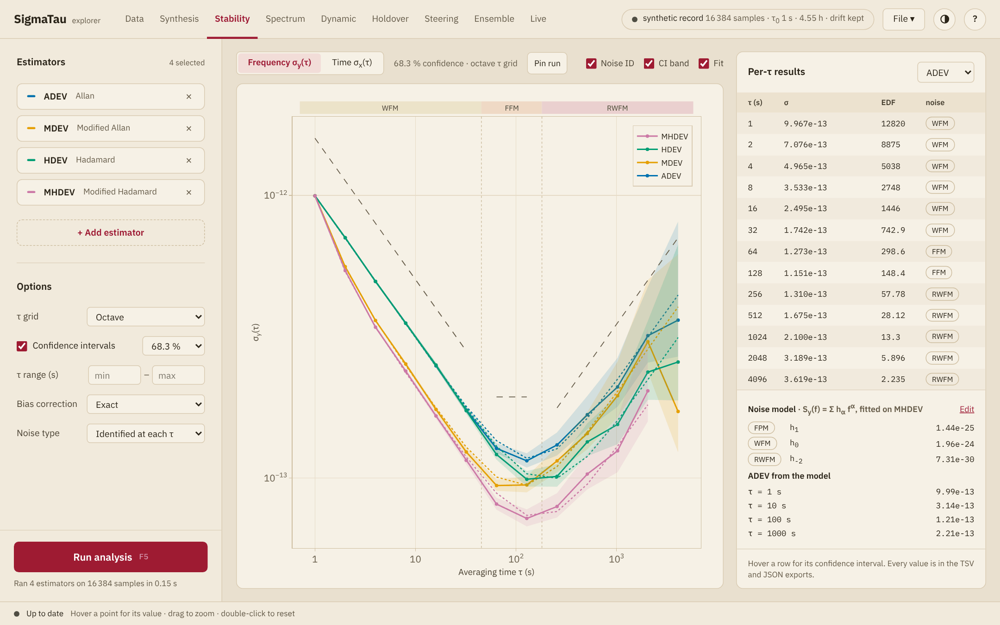

# The explorer

The explorer is the package with a window. It opens a record, checks it and
shows the deviations, the spectra, the dynamic deviation and the time error
in holdover of one clock or of several, with every setting on screen. It
also simulates clocks from a noise model, forms a time scale from a group
of clocks and follows a measurement while it runs.

Every result it shows is computed by the [`sigmatau`](../guide/cli.md)
program, which runs the code of the Julia functions. The report of an
analysis lists the command lines that repeat it.

The explorer comes as a desktop app and as pages that a script serves to a
browser. Both show the same pages, and [Install and run](install.md) covers
the two.

## A first analysis

The explorer starts with a simulated record of 16384 phase samples at 1 s
and its analysis, so that every page has something to show before a file is
open.

1. **Open the record.** On the [Data](data.md) page press **Open a
   file…**, or drop a file anywhere in the window. The import dialog shows
   the top of the file and asks what each column holds, whether the
   readings are phase or fractional frequency, and in which unit.
2. **Check it.** The record check lists the samples, the span, the gaps, the
   points past 5σ and the frequency drift, beside a plot of the phase.
   Drift removal, gap filling and outlier removal are set there.
3. **Choose the estimators.** **+ Add estimator** in the
   [side panel](panel.md) opens the list. The τ grid, the confidence level,
   the bias correction and the noise type are under **Options**.
4. **Run the analysis** with **Run analysis** or F5.
5. **Read the results** on the [Stability](stability.md),
   [Spectrum](spectrum.md), [Dynamic](dynamic.md),
   [Holdover](holdover.md) and [Steering](steering.md) pages.
6. **Keep them.** The **File** menu saves the plot, the numbers, a report
   and the whole [session](export.md).

## The window

| Part | Holds |
|:-----|:------|
| Tabs | The nine pages: [Data](data.md), [Synthesis](synthesis.md), [Stability](stability.md), [Spectrum](spectrum.md), [Dynamic](dynamic.md), [Holdover](holdover.md), [Steering](steering.md), [Ensemble](ensemble.md) and [Live](live.md) |
| Record chip | The record in use: its name, the number of samples, the sample interval, the span and what was removed from it. With several clocks, their number and the samples in all. A click opens the Data page. A window 1100 px wide or narrower leaves the chip out |
| **File** menu | The [exports](export.md): the plot, the results, a report, and saving and opening a session |
| Theme button | Switches between the colors of the system, a light theme and a dark theme. The choice is remembered |
| **?** | The [help](#The-help): a search through this manual and its sections on the page in view |
| [Side panel](panel.md) | The clocks, the estimators and the options of the analysis, with the **Run analysis** button. On Synthesis, Ensemble and Live it holds the settings of that page |
| Status bar | Whether the results on screen belong to the inputs on screen |

## When results are computed

A change to the record, to the estimators or to the options does not start
an analysis, and neither does a file that has just been opened. The Run
button and the status bar turn amber, and the Stability and Spectrum pages
keep the results of the last run until **Run analysis** is pressed again. A
run can be canceled, and the results from before then stay on screen.

The explorer runs the analysis by itself in five cases: at start, on its
simulated record; when the reference clock changes and there are results;
when a session is opened; when the readings of a live measurement are
loaded; and after each change to a noise model built by hand.

| Shown | Computed |
|:------|:---------|
| Stability, Spectrum | By **Run analysis** |
| The record check and the phase plot of Data | When the record or its preparation changes |
| The frequency drift fit of Data | When its model changes |
| Dynamic, Holdover, Steering | When the page is shown and the record or its settings have changed |
| The predicted stability of Synthesis | When a value is entered |
| Ensemble | When the page is shown and the clocks or its settings have changed |
| Live | With every batch of readings |

## Keyboard and mouse

| Key | Action |
|:----|:-------|
| F5, or Ctrl+Enter (Cmd+Enter on macOS) | Run the analysis. During a run: cancel it, or start it again if the inputs have changed since |
| 1 to 9 | Data, Synthesis, Stability, Spectrum, Dynamic, Holdover, Steering, Ensemble, Live |
| ? | The help menu |
| F1 | The help on the page in view |
| Esc | Cancel a run, close a dialog or the help menu |

On a plot, hovering shows the values, a drag zooms and a double click
restores the full range.

## The help

The help is this manual inside the explorer, without its screenshots.
**?** in the top bar, or the ? key, opens the help menu:

| Entry | Opens |
|:------|:------|
| **Search the help** | The sections in which every word typed begins a word, those with the words in their title first. `tau`, `sigma` and the names of the other Greek letters of the manual also find the letter. Enter opens the first section listed |
| **On this page** | The sections of the manual on the page in view |
| **Contents of the help** | The manual from its first page, with its pages listed beside the text |
| **Keyboard and mouse**, **Estimators and noise types** | Those two parts of the manual |
| **Documentation on the web** | The documentation of the package in the browser, with the reference of the Julia functions and of the command line |

F1 opens the help on the page in view. A link from the help to another part
of the documentation opens in the browser.
