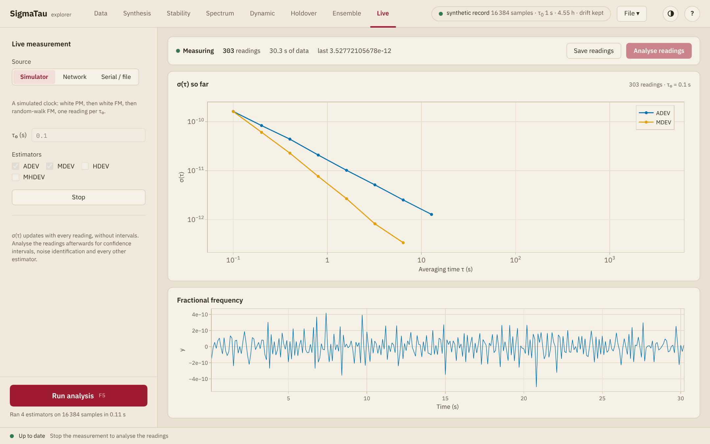

# Live

The Live page follows a measurement while it runs. It reads one reading at
a time from an instrument or from a simulator and updates the deviations
with each one, so that the curve fills in toward long averaging times as
the record grows.

## The source

| Source | Reads from | Fields |
|:-------|:-----------|:-------|
| **Simulator** | A simulated clock with white PM, white FM and random-walk FM, at one reading per sample interval | None |
| **Network** | The SCPI socket of an instrument on the network, as an LXI instrument offers, on port 5025 as a rule | **Address**, as `host:port`, and **Query** |
| **Serial / file** | A serial port, or a file of readings, which is read to its end at once | **Path** and **Query** |

The **Query** is sent before every reading. For the network it is `READ?`
at first. Leave it empty for an instrument that sends readings by itself.

A serial port has to be set up before the measurement starts, since the
explorer opens it as a file. On Linux, `stty -F /dev/ttyUSB0 9600 raw` sets
the line speed, and on macOS `stty -f` does.

From a browser, the serial port and the file are those of the computer
that runs [`serve.py`](install.md#In-a-browser,-from-the-repository), which
serves them only on its default address.

## The readings

A reading is the first number on a line. Other fields on the line, after a
comma, a semicolon or a blank, are ignored.

| Setting | Meaning |
|:--------|:--------|
| **Readings** | **Counter frequency (Hz)**, **Fractional frequency** or **Phase (s)**. The simulator gives phase |
| **Nominal (Hz)** | The frequency that counter readings are measured against. Left empty, it is the first reading rounded to four significant digits |
| **τ₀ (s)** | The time from one reading to the next, such as the gate time of the counter |
| **Estimators** | Any of ADEV, MDEV, HDEV and MHDEV |

A counter reading ``ν`` becomes the fractional frequency ``y = ν/ν_0 - 1``
against the nominal frequency ``ν_0``. A nominal value that is off by a
little adds a constant frequency offset, which none of the four deviations
responds to.

The sample interval is not measured: set it to the time from one reading
to the next. Frequency readings are taken as averages over that whole
time. Dead time between the readings is not corrected for
([Counter readings](../guide/choosing.md#Counter-readings)).

A measurement cannot skip a reading. When an instrument answers with the
SCPI value for no measurement, `9.91E+37`, or with a line that does not
start with a number, the measurement stops with that as its error.

## While it runs

**Start** begins the measurement and **Stop** ends it. The bar at the top
gives the state, the number of readings, the time they span and the last
reading. The two plots are updated about four times a second:

| Plot | Shows |
|:-----|:------|
| **σ(τ) so far** | The chosen deviations of all the readings so far, on the octave grid |
| **Fractional frequency** | The fractional frequency of the last 5000 readings |

The deviations are those of [`adev`](@ref), [`mdev`](@ref), [`hdev`](@ref)
and [`mhdev`](@ref) on the readings so far, updated with running sums as
[`StreamingStability`](@ref) keeps them
([Dobrogowski and Kasznia (2007)](@cite dobrogowski-2007-realtime-adev)).
They carry no confidence intervals and no noise types. Hovering over a
point shows the number of terms behind it. The points at the longest
averaging times rest on few terms and move the most.

## Afterwards

| Button | Action |
|:-------|:-------|
| **Save readings** | Saves the readings as a text file, one per line, under a line that states the record type, the sample interval and the source. Counter readings are saved as fractional frequency |
| **Analyse readings** | Loads the readings as a new clock, opens the [Stability](stability.md) page and runs the analysis, with confidence intervals, noise types and every estimator of the list. It needs a stopped measurement of 16 readings or more |
