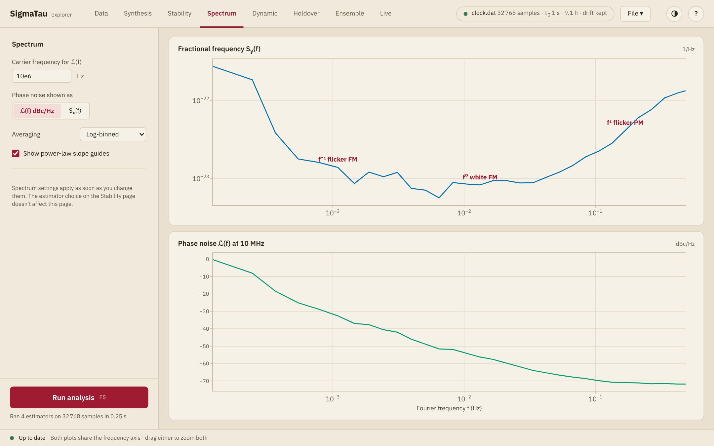

# Spectrum

The Spectrum page shows the record in the frequency domain: the spectrum of
the fractional frequency, ``S_y(f)``, above the phase noise ``ℒ(f)`` at a
carrier frequency or the spectrum of the phase, ``S_x(f)``. The two plots
share the frequency axis, and a zoom in one zooms the other.

## What is computed

Every run computes the two spectra of each clock, from the record as
prepared on the [Data](data.md) page and within its analysis range. The
estimator choice of the panel has no part in them.

Both are one-sided densities by Welch's method, as [`psd_y`](@ref) and
[`psd_x`](@ref) compute them: the record is cut into segments that overlap
by half, each segment is tapered with a Hann window, and the squared
transforms are averaged. The segment is the largest power of two up to a
quarter of the record. The frequencies run from the reciprocal of the
segment's duration to ``1/(2τ_0)``.

| Plot | Quantity | Unit |
|:-----|:---------|:-----|
| Upper | ``S_y(f)``, fractional frequency | 1/Hz |
| Lower | ``ℒ(f)`` at the carrier | dBc/Hz |
| Lower | ``S_x(f)``, phase as time | s²/Hz |

!!! warning "The low end of the lower plot"
    The phase spectrum of FM noise is steep, and the taper then leaks power
    from the lowest frequencies into the bins above them. In simulation the
    estimate of ``S_x(f)`` is within 2 % from the eighth bin on for white
    and flicker FM, and on random-walk FM it is still twice too high at the
    16th bin ([`psd_x`](@ref)). On a record with such noise, read the low
    frequencies from ``S_y(f)``, which is less steep by ``f^2``. Its first
    bin should not be read either ([`psd_y`](@ref)).

## Settings

The settings change what is shown, and they apply at once, without a run.

| Setting | Effect |
|:--------|:-------|
| **Carrier frequency for ℒ(f)** | The carrier ``ν_0`` in hertz, 10 MHz at first. It takes a number such as `10e6` |
| **Phase noise shown as** | **ℒ(f) dBc/Hz** or **Sx(f)** in the lower plot |
| **Averaging** | **Log-binned** shows the mean of the density in ten bins per decade of frequency. **Welch, every bin** shows the estimate as computed |
| **Show power-law slope guides** | Labels the stretches of ``S_y(f)`` whose slope is close to that of a power law |

The phase noise follows from the phase spectrum as
``ℒ(f) = \frac{1}{2}(2πν_0)^2 S_x(f)``, in decibels
([IEEE Std 1139-2022, Eqs. (A.13) and (A.15)](@cite ieee1139-2022-definitions)).
The record gives ``S_x(f)``, and the carrier only scales it: the phase
noise of one record reads 20 dB higher at 100 MHz than at 10 MHz.

## Slope guides

With one clock, a label such as **f⁰ white FM** marks a stretch of
``S_y(f)`` with the slope of one noise type. The log-binned spectrum is cut
into three stretches of equal numbers of points, a line is fitted to each
on logarithmic axes, and a stretch is labeled when its slope is within 0.35
of a whole number from −2 to 2.

The stretches are fixed, so one that spans two noise types is labeled by
its mean slope. The record of the figure above has white PM, white FM and
random-walk FM, and no flicker noise: its first and last stretches each
span two of them.

| Slope of ``S_y(f)`` | Noise |
|:--------------------|:------|
| ``f^2`` | White PM |
| ``f^1`` | Flicker PM |
| ``f^0`` | White FM |
| ``f^{-1}`` | Flicker FM |
| ``f^{-2}`` | Random-walk FM |

[Power-law noise](../explanation/noise.md) relates these slopes to those of
the deviations.

## Several clocks

With several clocks, the spectra are overlaid in the colors of the clocks,
the settings move to a bar above the plots, and no slope guides are drawn.

## Records with gaps

The spectra need a record without missing samples. A run analyzes a record
with gaps without its spectrum, and the page then shows **No spectrum: the
record has gaps** in place of the plots. Beside other clocks, a line above
the plots names the clock that has none. Fill the gaps on the
[Data](data.md#Preparing-the-record) page, or choose an analysis range
without them.
