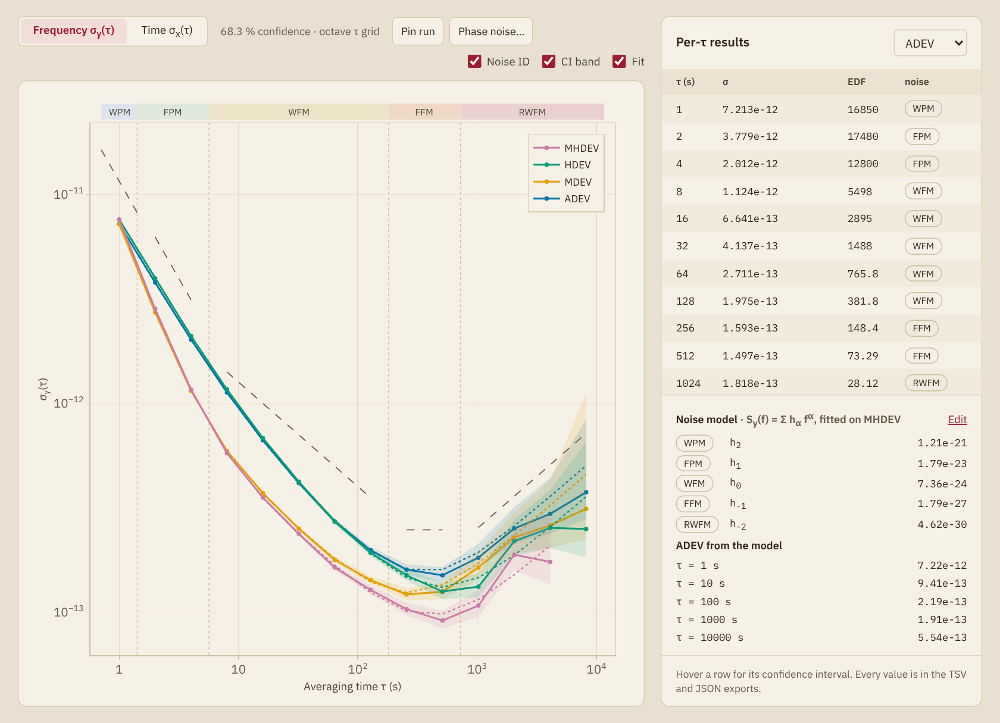
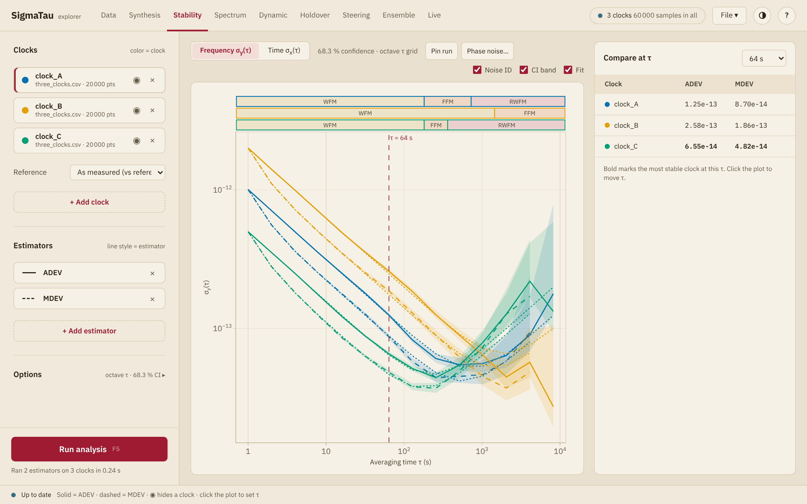

# Stability

The Stability page plots the deviations of the last run against the
averaging time, on logarithmic axes, and lists their values. The explorer
opens on this page.

## The plot

**Frequency σy(τ)** and **Time σx(τ)** switch between the two kinds of
estimator: the fractional frequency deviations, which have no unit, and the
time deviations, in seconds. The page shows the estimators of one kind at a
time. [Estimators and noise types](estimators.md) lists which is which.

With one clock, each estimator is a line in its own color, named in the
legend. With several clocks the color is that of the clock and the line
style that of the estimator, and the status bar lists the line styles.

The line beside the two buttons states the settings of the
[side panel](panel.md#Options): the confidence level, the τ grid, the bias
correction when an estimator that takes one is in the list, and the noise
type when it is not identified at each averaging time.

| Control | Effect |
|:--------|:-------|
| **Noise ID** | Shows the noise type identified at each averaging time in a strip above the plot |
| **CI band** | Draws the confidence intervals as a shaded band. Without it they are error bars |
| **Fit** | Draws the [noise model](#The-noise-model) and lists its coefficients |
| **Pin run** | Keeps the curves of this run on the plot, as [pinned runs](#Pinned-runs) |
| **Phase noise…** | Draws the deviations that a [table of phase noise](#A-phase-noise-table) gives |
| Mask menu | On the time axis, draws a [telecom mask](#Masks) |

Hovering over a point shows its averaging time and value, with the EDF and
the noise type behind its interval. MTIE and TIE rms have no interval.

**Noise ID** and **CI band** need the confidence intervals, since the noise
types are identified for them. Both are disabled while **Confidence
intervals** is off in the panel.

## Noise identification

The strip above the plot shows the noise type that the run identified at
each averaging time, joined into stretches of one type. It comes from the
first estimator in the list that reports noise types, and it is shown on
the frequency axis only. [Noise types](estimators.md#Noise-types) explains
the labels, and
[Noise identification](../explanation/noise_identification.md) says how
they are found.

A label is what the test reads at that averaging time, and not always a
noise that the record holds. The record of the figure above has white PM,
white FM and random-walk FM. Its stretches of FPM and FFM lie where two of
them cross, and there the test reads the type between them
([How far to trust a label](../explanation/noise_identification.md#How-far-to-trust-a-label)).

With one clock, a dashed line along each stretch has the slope of that
noise type in that estimator, drawn a little above the curve, and dotted
vertical lines mark where the type changes. A curve that leaves its guide
has a mixture of noises there, or a label that does not fit. With several
clocks there is one strip for each clock, outlined in its color, and no
guides.

## The table

With one clock, **Per-τ results** lists the values of the estimator chosen
in its menu:

| Column | Holds |
|:-------|:------|
| **τ (s)** | The averaging time |
| **σ** | The deviation |
| **EDF** | The equivalent degrees of freedom of the estimate |
| **noise** | The noise type at that averaging time |

Hovering over a row shows its
[confidence interval](../explanation/confidence.md) and the number of terms
in the estimate. Every value is in the TSV and JSON
[exports](export.md).

## The noise model

**Fit** draws a power-law model of the noise of the record,
``S_y(f) = \sum_α h_α f^α``, as a dotted line under each curve of ADEV,
MDEV, HDEV, MHDEV and TDEV: the deviation that the model gives in that
estimator. Under the table, **Noise model** lists the coefficients ``h_α``
above zero and the ADEV that the model gives at 1 s, 10 s, 100 s, 1000 s,
``10^4`` s and one day, as far as half the span of the record.

The model is fitted to the MHDEV of the record on the octave grid, by
nonnegative least squares over the five noise types from white PM to
random-walk FM, as [`powerlaw_fit`](@ref) does. It does not depend on the
estimators in the list or on the τ grid. A noise that the record does not
have comes out small and positive, so compare the dotted lines with the
curves before using a coefficient.

### A model built by hand

**Edit** opens a list of components that takes the place of the automatic
fit. Choose a noise type, give the span of averaging times over which it
dominates the MHDEV, and press **Add**. An empty field leaves that end of
the span open. The level of the noise is fitted over its span to what the
other components leave of the MHDEV, and every level is fitted again when a
component comes or goes, as [`add_component!`](@ref) does. The explorer
runs the analysis after each change.

While the list is open, a dashed gray line shows the MHDEV that the
components leave. **Undo** removes the last component, and **Back to the
automatic fit** removes them all. Each of the seven noise types enters
once.

The choice **From the fitted model** of the option **Noise type** uses the
automatic fit, also when a model has been built by hand.

## Masks

On the time axis, the menu beside the checkboxes draws the limits of an
ITU-T wander mask over MTIE and TDEV. With one clock, a card under the
table says how each of the two compares:

| Text | Meaning |
|:-----|:--------|
| **passes, 8.6× under** | Every value is at or under its limit, the closest by a factor of 8.6 |
| **fails, 2.1× over** | The worst value is over its limit by a factor of 2.1 |
| **no τ in the mask's range** | The mask does not cover an averaging time of the run |

| Menu entry | Mask |
|:-----------|:-----|
| **G.811 PRC**, **G.811.1 ePRC** | Wander generation of a primary reference clock, and of an enhanced one |
| **G.812 type I**, **types II, III** | Wander generation of a node clock of type I, and of types II and III |
| **G.813 SEC opt 1**, **opt 2** | Wander generation of an SDH equipment clock, options 1 and 2 |
| **G.8262 EEC opt 1**, **opt 2**, **G.8262.1 eEEC** | Wander generation of a synchronous equipment clock, options 1 and 2, and of an enhanced one |
| **G.8272 PRTC-A**, **PRTC-B**, **G.8272.1 ePRTC** | Wander generation of a primary reference time clock of class A and of class B, and of an enhanced one |
| **G.823 PRC**, **SSU**, **SEC**, **PDH interface** | Network limits for wander at the four kinds of interface |

The card, and the label that appears when the pointer is on the line,
name the edition and the tables of the recommendation that the limits
were read from. [`TELECOM_MASKS`](@ref) lists them. The recommendations measure MTIE and
TDEV through a 10 Hz low-pass filter, or at one sample per second without
a filter for the 1 PPS output of a time clock. The explorer applies no
filter and compares the record as it was measured, as [`mask_check`](@ref)
does.

## Pinned runs

**Pin run** keeps the curves of the last run on the plot, as thin broken
lines under those of every later run. Each pin is a chip beside the button,
**Pin 1**, **Pin 2**, and hovering over it lists what its run was: the
estimators, the τ grid, the analysis range and the drift removal. ×
removes the pin.

A pin shows what a change does: pin, change the drift removal, the range or
the bias correction, and run again. Pins are part of the plot and of its
image. They are not in the other exports or in a saved session.

## A phase-noise table

**Phase noise…** opens a file with two columns, the offset frequency in Hz
and the phase noise ``ℒ(f)`` in dBc/Hz, as a phase-noise analyzer exports
it or as a data sheet lists it. Lines of text above the numbers are
skipped. The explorer converts the table to ADEV, MDEV, TDEV, HDEV and
MHDEV with [`spectrum_sigma`](@ref), at the carrier frequency set on the
[Spectrum page](spectrum.md), and draws those of the estimators in the
list as broken lines, like a pinned run. Its chip is **ℒ(f) 1**, and ×
removes it.

A table covers a band of offset frequencies, and the curves are the
deviations of the noise inside that band. They run from the shortest
averaging time that the band resolves, one over its highest offset, to a
tenth of one over its lowest. Hovering over the chip gives the band, how
much the noise below it would add to the Allan variance at the longest
averaging time, and whether ADEV and HDEV depend on the bandwidth of the
measurement: on white and flicker PM they do, and the curves then hold for
a bandwidth equal to the highest offset of the table.
[Power-law noise](../explanation/noise.md#A-measured-spectrum) has the
conversion.

A table of a few offsets beside a record measured at one-second intervals
puts the short and the long averaging times of one oscillator on one plot.
Like a pin, the table is not in a saved session.

## Several clocks

With several clocks the table is **Compare at τ**: the value of each clock
at one averaging time, for the first three estimators of the list on the
axis shown. The lowest value in each column is in bold, which marks the
most stable clock at that averaging time. A click on the plot moves the
averaging time to the nearest one of the run, and a dashed line marks it.
The menu of the card does the same.

