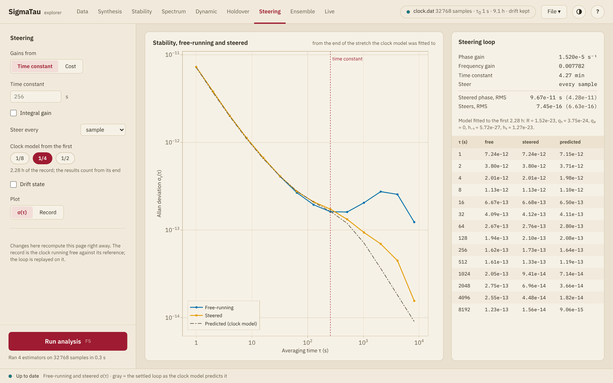

# Steering

The Steering page replays a steering loop on the record. The record is the
clock running free against its reference, and the page shows what the loop
would have made of it. A [Kalman filter](../reference/kalman.md) estimates
the phase and the frequency of the clock from the readings, and each steer
changes the frequency of the clock by a gain times each estimate. The loop
is that of [`steer`](@ref), which [Steering](../reference/steering.md)
describes.

## Settings

| Setting | Effect |
|:--------|:-------|
| **Gains from** | **Time constant**, the gains of a critically damped loop with that time constant, by pole placement, or **Cost**, the gains that minimize a weighted sum of phase², frequency² and steer² |
| **Time constant** | In seconds. Empty, it is 1/128 of the record, the value that the field shows in gray |
| **Integral gain** | A third gain, on the running sum of the estimated phase |
| **Weights on** | With **Cost**, the weights on **phase²**, **frequency²** and **steer²**. Those on phase² and steer² are above 0. A larger weight on steer² gives a slower loop with smaller steers |
| **Steer every** | A steer at every sample, or at every 2 to 64 samples. The gains are worked out for that interval |
| **Clock model from the first** | **1/8**, **1/4** or **1/2** of the record, the stretch to which the clock model of the filter is fitted. The line below gives its length |
| **Drift state** | The model also holds a frequency drift, which the loop steers out ahead |
| **Plot** | **σ(τ)** or **Record** ([below](@ref explorer-steering-plot)) |

The [clock model](../explanation/clock_model.md) is fitted to the first
stretch alone and keeps the flicker FM and the flicker PM that the fit
finds, as that of the [Kalman filter](@ref explorer-holdover-kalman) on the
Holdover page. The loop runs over the whole record, and every result
counts from the end of that stretch, so the loop is not judged on readings
that its model was learned from.

The page computes when it is shown and again when the record, its
preparation, its analysis range or a setting changes. It needs no run. Of
the side panel it takes the τ grid alone. The record needs 64 samples or
more.

## [The plot](@id explorer-steering-plot)

With **σ(τ)** the plot gives the Allan deviation against the averaging
time, on logarithmic axes.

| Curve | Shows |
|:------|:------|
| **Free-running** | The Allan deviation of the record |
| **Steered** | That of the steered record |
| **Predicted (clock model)** | That of the readings of the settled loop as the clock model gives it, the [`SteeringPrediction`](@ref) of `steer(model, gains; readings=true)`. It is drawn for a steer at every sample |

A dotted vertical line marks the longest time constant of the loop.

With **Record** the plot gives the steered phase over the whole record,
and on the right axis the frequency correction in force. A dotted line
marks the end of the stretch that the model was fitted to.

The card beside the plot lists the phase gain, the frequency gain and the
integral gain if there is one, the time constants of the loop, which come
from its poles, and how often it steers. Where the poles are complex,
**Rings with period** gives the period of the overshoot. Below come the
RMS of the steered phase and of the steers, each with the value that the
model predicts in parentheses, the model itself, and a table of the three
deviations at each averaging time.

## Reading it

- Well below the time constant the steered clock follows the free-running
  one. Well above it the steered deviation falls as ``1/τ``, because the
  phase is held to the reference.
- A shorter time constant holds the phase closer and steers harder. On the
  simulated record that the explorer starts with, time constants of 32,
  128 and 512 s gave a steered phase of 7, 21 and 91 ps RMS, and steers of
  4.9, 1.5 and 0.65 parts in 10¹⁵ RMS.
- A steered curve above the predicted one says that the clock had more
  noise there than the model fitted to the first stretch.
- Gains from a cost with no weight on frequency² give a loop that rings a
  little, and the card gives the period.
- A frequency drift that the model does not hold leaves the steered phase
  off zero. **Drift state** removes the offset. An integral gain centers
  the filter's estimate of the phase and not the phase itself, as
  [Steering](../reference/steering.md#The-integral-gain) explains.

## Several clocks

With several clocks, the settings move to a bar above the plot, and each
clock has one color. With **σ(τ)** its steered deviation is a solid line
and its free-running one a dashed line, and the prediction is not drawn.
With **Record** the plot gives the steered phase of each clock. The card
lists the RMS of the steered phase and of the steers of each clock.
