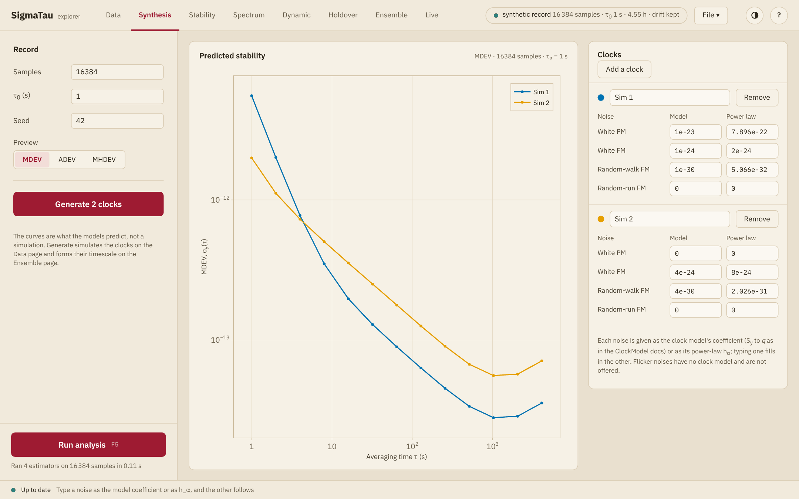

# Synthesis

The Synthesis page defines the noise of up to eight simulated clocks, plots
the stability that each noise model predicts, and simulates the clocks. It
answers what a clock of a given noise looks like in a deviation, and it
makes records with known noise for trying estimators and time scales.

## The noise of a clock

A clock is the sum of up to four noises. Each has two fields, which hold
the same level in two forms: the coefficient of the
[clock model](../explanation/clock_model.md) and the coefficient ``h_α`` of
the power law ``S_y(f) = h_α f^α``. Typing one fills in the other. A level
of 0 leaves the noise out.

| Noise | Model | Unit | Power law |
|:------|:------|:-----|:----------|
| White PM | ``R`` | s² | ``h_2 = 8π^2τ_0 R`` |
| White FM | ``q_1`` | s | ``h_0 = 2 q_1`` |
| Random-walk FM | ``q_2`` | 1/s | ``h_{-2} = q_2/(2π^2)`` |
| Random-run FM | ``q_3`` | 1/s³ | ``h_{-4} = q_3/(8π^4)`` |

The conversions are those of [`ClockModel`](@ref). ``R`` is the variance of
the white PM of one phase sample, so the ``h_2`` that goes with it changes
with the sample interval. The page offers no flicker noise.
[`noise_gen`](@ref) simulates it in Julia.

**Add a clock** adds a clock with the noise of the last one, and **Remove**
takes one out. The name of a clock is the field beside its color.

## Predicted stability

The plot shows the deviation that each model predicts, at the averaging
times of the octave grid for a record of **Samples** samples at the sample
interval **τ₀**. **Preview** chooses MDEV, ADEV or MHDEV. The curves are
computed in closed form, as [`powerlaw_sigma`](@ref) does, and they follow
each value as it is entered. Nothing is simulated for them.

ADEV and MDEV do not converge for random-run FM. A clock that has it is
drawn in MHDEV alone.

## Generating the clocks

**Generate** simulates the clocks with **Samples**, **τ₀** and **Seed**, as
[`simulate_clock`](@ref) and [`simulate_ensemble`](@ref) do. The same seed
gives the same records. Several clocks are simulated against one ideal
reference, as columns that share their instants.

The clocks are added to those already loaded. One clock opens on the
[Data](data.md) page, and two or more open on the [Ensemble](ensemble.md)
page, which forms a time scale from them. **Run analysis** then analyzes
them like any other record.

| Field | Range |
|:------|:------|
| **Samples** | A whole number, 64 or more |
| **τ₀ (s)** | Above 0 |
| **Seed** | A whole number, 0 or more |
